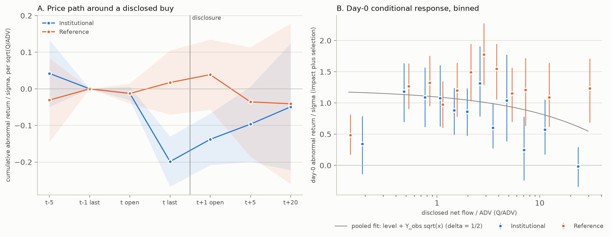
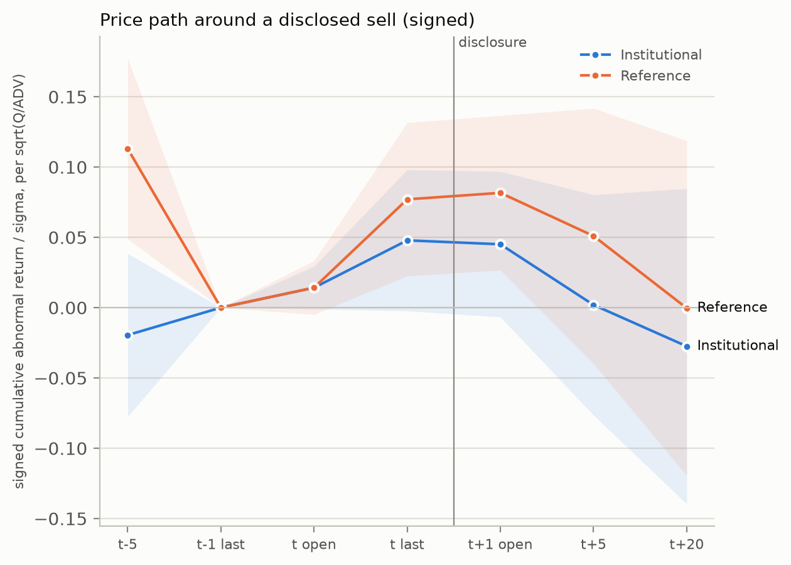

# What Does a Disclosed Large Trade Tell the Market? NSE Bulk Deals, 2010 to 2026

NSE publishes every bulk deal after the close: client name, side, quantity and average price. SEBI requires this "on the same day after market hours", and the file appears around 19:00 IST. Before that, no public channel reveals who traded.

The return from the last trade of day t to the next morning's call-auction open therefore brackets one moment: when the trader's identity and size become public. This project measures how much the price moves at that moment per unit of disclosed flow, and whether the move depends on who the buyer is:

- **Institutional (I):** mutual funds, insurers, pension and sovereign funds, foreign portfolio investors.
- **Reference (R):** individuals, HUFs, unaffiliated corporates.

The design was argued out by four adversarial reviewers and settled by a judge ([docs/PLAN.md](docs/PLAN.md)). Two confirmatory tests were pre-registered and frozen under git tags before their outcomes were computed:

- **Buys:** tag `spec-v1`, [docs/SPEC.md](docs/SPEC.md). Underpowered, so reported as descriptive.
- **Sells:** tag `spec-v2`, [docs/SPEC_v2.md](docs/SPEC_v2.md). Powered: I 1,031, R 1,067.

**Headline.** A disclosed institutional buy is followed by an overnight premium of about 3× the reference level per unit of √size (descriptive). On disclosed sells, the powered test finds no difference between institutions and reference sellers, and no overnight response at all.

## Identification

| Leg | Definition | Role |
|---|---|---|
| `g1` | ln(O_{t+1} / LAST_t) | **Causal leg.** It spans only the disclosure. |
| `id` | ln(LAST_t / O_t) | Day 0. Descriptive only: traders condition on the intraday path. |
| `ov` | ln(O_t / LAST_{t-1}) | Pre-trade overnight. |
| `d15`, `d620` | Open t+1 to day t+5, then t+5 to t+20 | Decay, for the retention tests. |
| `r_m1`, `r_m5` | Returns over t-2 to t-1 and t-6 to t-1 | Placebo loadings. Run-up means the group is anticipated. |

Choices behind the legs:
- **Baseline is LAST, not the official close.** Before 3 August 2026 NSE's close is the 15:00 to 15:30 VWAP, which averages over pre-disclosure prices. `g1c` (the official-close baseline) is kept as robustness check 1.
- **Window starts 1 April 2013.** From that date the next-day open is a call-auction price for every EQ stock.
- **Window ends 31 July 2026,** before the closing auction arrives on 3 August 2026.
- **All legs are abnormal.** Each is the event's leg minus the same-date mean leg of non-event stock-days in the same bucket, divided by an ex-ante Garman-Klass σ.

## Data

All data comes from NSE public archives and APIs. There are 14,940 raw files in a write-once store. Each file is sha256-hashed in `manifest.jsonl`; the manifest's own hash is `d7873714...34e2`.

| Source | Coverage | Used for |
|---|---|---|
| Bulk and block deals (CSV API, 12-month windows) | 2004 onward | Client-day flows. JSON mode silently truncates at 70 rows. |
| Legacy bhavcopy | 2009 to 5 Jul 2024 | OHLC, LAST, volume, value, ISIN |
| UDiFF bhavcopy | 1 Jan 2024 onward | The same, after the format change. It matches legacy exactly on all 276,472 overlap rows. |
| MTO | to Jun 2020 | Delivered quantity |
| sec_bhavdata_full | Oct 2019 onward | Delivered quantity and VWAP. Matches MTO exactly on the overlap. |
| PR zips (`bh` band-hit list) | 2010 onward, 100% of 4,143 trading days | Price-band censoring |
| PIT insider filings | 2016 to Mar 2026 (337,836 records) | Promoter, director and KMP identities |
| Corporate actions, board meetings, results | 2005 onward | Split and bonus factors, news filters |

## Pipeline

1. **Symbols.** Symbol-change chains are resolved to one canonical symbol per security. The resolution is date-aware, so reused tickers are handled.
2. **Adjustment.** NSE's legacy PREVCLOSE is *not* adjusted on ex-dates.
   - Split and bonus factors are parsed from corporate-action subject text, including abbreviated and glued forms.
   - A factor with |ln f| ≥ 0.3 is applied only when the ex-date price jump confirms it: 1,063 of 1,067 (99.6%) are confirmed.
   - For arrangements and demergers, the observed gap is used instead.
3. **Flows.**
   - **Block-window netting.** The bulk file aggregates a client's day across the normal, block (BL) and institutional (IL) windows. Block-file legs are subtracted by client, side and stock-day, and the remainder is repriced. After this, 0 of 102,982 client-days exceed daily volume.
   - **Crosses.** Exact 1:1 buyer-seller quantity matches are flagged.
   - **Scope.** SME, depository-receipt and fund-unit (INF ISIN) deals are flagged out of scope.
4. **Panel.** Built on the market calendar (weekend Muhurat and special sessions included), in 200-symbol chunks so memory stays bounded.
   - **ADV:** median volume over [t-60, t-6], with at least 30 days and disclosure days excluded.
   - **σ:** Garman-Klass variance over [t-70, t-11], with at least 40 days and band-hit days excluded.
   - **Benchmark days:** no disclosure anywhere in [t-5, t+20].
   - **Buckets:** 5 turnover quintiles × 3 σ terciles, with cut points recomputed each year.
5. **Price-band censoring.** A price rule alone flagged band hits with 99.4% recall but only 47.2% precision against NSE's own list, because it also flags 2% and 5% moves of wider-band stocks. Every band flag therefore requires the stock and side to appear in that day's `bh` file.
   - `LAST_t` at a band: the event is excluded, because unfilled demand spills into the open.
   - Next open at a band: `g1` is censored at its observed value.
6. **Event flags.** All flags are backward-looking only.
   - **Isolated:** the same client did not disclose in the stock over the previous 20 trading days, and nobody disclosed in the stock over the previous 5.
   - **Novel:** the client did not disclose in any stock over the previous 250 days. This applies to R only.
   - **News:** a board meeting or ex-date on t or t+1, or a results broadcast between 15:30 on t-1 and 09:00 on t+1.

## What is data, and what is the author's judgement

**NSE does not publish a trader category.** The I / R / P / S labels are constructed by this project, not observed. Everything downstream of them inherits that.

Three inputs are judgement, not data, and none of them is sourced from a filing:

1. **The name-pattern rules** (`trader_types.py`). Hand-written regular expressions: "MUTUAL FUN" implies a fund, "FVCI" implies a sponsor, and so on. They are deterministic and auditable, but they were written by the author.
2. **The hand dictionary** (`client_types.csv`, 29 entries). Its `evidence` column is explicit:
   - **`unverified_recall` (26 entries): the author's recollection of who a client is. It is NOT read from a filing, an NSE record, or any other source, and it may simply be wrong.** Examples: "Hulst B V is a Baring PE vehicle", "Twin Star Holdings belongs to the Vedanta group".
   - `name_inference` (3 entries): read off the name itself, for example AustralianSuper being a pension fund.
3. **The typing-audit verdicts** (`typing_audit_*.csv`, 1,000 names over five rounds). These are the author's calls, again partly from recollection, and rows carry `[uncertain, kept]` where the author could not decide. They set the **measured accuracy** (94.5%); they never change any client's type.

**A label assigned by hand is an intervention.** So the point of the dictionary is measured, not asserted: `uv run impact sensitivity` re-types every client-day from the raw deals with the dictionary cut down or removed, rebuilds the stock-day types, and re-runs both tests.

| Dictionary | Test | n_I | n_R | events touching a dictionary name | θ_I | θ_R | z | p |
|---|---|---|---|---|---|---|---|---|
| Full (29) | v1 buys | 791 | 751 | 0.97% | +0.061 | +0.022 | +2.86 | 0.004 |
| Name inferences only (3) | v1 buys | 778 | 751 | 0.13% | +0.061 | +0.022 | +2.83 | 0.005 |
| **None** | v1 buys | 778 | 751 | 0.13% | +0.061 | +0.022 | +2.83 | 0.005 |
| Full (29) | C2 sells | 1,031 | 1,067 | 0.91% | −0.003 | +0.005 | −1.20 | 0.231 |
| Name inferences only (3) | C2 sells | 1,023 | 1,073 | 0.81% | −0.001 | +0.004 | −0.89 | 0.376 |
| **None** | C2 sells | 1,021 | 1,079 | 0.81% | −0.001 | +0.005 | −0.89 | 0.375 |

**Reading.** Under 1% of the events in either cell involve a client the dictionary names. Deleting all 26 unverified entries moves the buy-side contrast from z = 2.86 to z = 2.83 and leaves the sell-side null a null. **Neither headline depends on the recalled labels.** What does depend on hand-written judgement is the rule set itself, and its measured accuracy is 94.5%, with errors that bias toward finding no difference.

**Not verified either:** the four adversarial "reviewers" and the "judge" in `docs/PLAN.md` were roles played during the design review, not outside experts. Every claim in the plan marked `[recalled]` carries the same warning as the dictionary: it is memory, not a checked source.

## Trader types

The rules are deterministic, and the first match wins:

1. hand dictionary (`client_types.csv`; mostly unverified recollection, see the section above);
2. prop-desk name patterns (P);
3. venture and private-equity sponsors (S);
4. regulated pools (I): sovereign, pension, insurer, mutual fund or trustee, endowment, AIF, bank or ARC;
5. strategic for this stock (S): a distinctive issuer token in the client name, or a PIT insider of the stock. Insiders are matched on the full name in any word order, on first plus last name, or on a surname shared with an insider when fewer than 30 client names carry that surname;
6. investment managers, FPI and fund name patterns (I);
7. behavioural churner (P): at least 5 disclosed client-days in the prior 365 days, at least 50% of them two-sided;
8. otherwise R (individual, HUF, trust or corporate).

**Stock-day type.** A stock-day takes the type that supplies at least 80% of the event side's directional (|net| ≥ gross/2), non-churner, non-cross quantity.

**Churner validation (M4).** On 10,331 churner-dominated stock-days, delivery share runs a median 22.8 points below the bucket-year median, and 89% of those days sit below it. Round trips do not take delivery, so this is what churning should look like.

**Typing audit.** Each round drew 200 names that no earlier round had seen, and the verdicts were recorded before scoring.

| Round seed | 20260914 | 20260915 | 20260916 | 20260917 | 20260918 (final) |
|---|---|---|---|---|---|
| Agreement | 90.0% | 92.0% | 94.5% | 93.5% | 94.5% |

The gate is 95%, so the final round misses it by one name. The errors run one way: 7 of 145 R-typed names are really institutions, and no I-typed name is really R. That contamination pulls θ_R toward θ_I by about 5%, so any rejection of H0 is conservative.

## Estimation

- **Primary model.** y = g1_abn / σ = θ_I·1{I}·√x + θ_R·1{R}·√x + λ_bucket + ε.
  - x = |net disclosed flow| / ADV, in split-adjusted shares.
  - ε follows a Student-t with ν = 4 and estimated scale. Upper and lower censoring comes from the confirmed band flags.
  - The fit is maximum likelihood (BFGS). A precision-loss exit is accepted only when max|score|/n ≤ 1e-6.
- **Inference.**
  - Two-way (stock, date) cluster-robust sandwich covariance (Cameron-Gelbach-Miller), built from per-event scores, with eigenvalues clipped to keep it positive semi-definite.
  - Cross-checked against pyfixest on OLS.
- **Primary cell.** Buys, 2013-04 to 2026-07, EQ series, backward-isolated, no news, `LAST_t` off the band, previous unadjusted price at least Rs 10, listed at least 70 days.
  - Common support: buckets holding both groups, with x inside the overlap of each group's 1st-to-99th percentile range.
- **Hypothesis.** H0: θ_I = θ_R, two-sided Wald test, α = 0.05.
- **Secondary tests** (Holm correction across the family):
  - **S1, information bound.** Institutional runs continue, so part of `g1` could be anticipated continuation. Each institutional outcome is reduced by Y_UB·(√(x + k·F-hat) − √x), where F-hat is fitted point-in-time from run-starts before t, and Y_UB = max(1, the upper 95% bound of the pooled day-0 scale). The test is θ*_I − θ_R > 0 for k = 1, 2, 3, and the breakdown k is reported.
  - **S2, retention.** The id, g1, d15 and d620 legs are stacked (censored t for id and g1, Huber with c = 1.345 for decay). The test is against the latent-order-book decay K(τ) = √(1+τ) − √τ, with K(5) = 0.213 and K(20) = 0.110; Wald nulls are φ∞ = 0 and φ∞ = 2/3. It runs only for groups whose placebo loadings are insignificant.
  - **S3, identity news on exact crosses.** α_I − α_R by buyer type, with seller-type fixed effects.
  - **S4, prop inventory.** b_g1(P) < 0.

## Gate record

| Gate | Result |
|---|---|
| **M0: raw store** | Manifest re-hash is clean. Bulk rows for 2010 to 2019 number 76,784, which is −5.8% against Rajvanshi (2021). The live-snapshot check ran on 1 of the 5 days it needs (exception). |
| **M1: clean panel** | All pass: weekend sessions, factor confirmation, 100% of in-scope client-days priced, Q/V ≤ 1, bhavcopy and delivery overlaps, VWAP. |
| **M2: census and power** | Band lists cover 100% of days. Power gate **failed**: the primary cell has I 814 and R 785, against 1,000 needed per group. By pre-registration the primary is therefore descriptive, and the headline is D1 plus S2. |
| **M3: Rajvanshi replication** (pooled) | Buy day-0 AR is +2.46% against +1.56% for sells, peaking on day 0 and reversing over days +1 to +7. |
| **M4: typing** | Delivery gate passes. Typing audit 94.5% (exception above). |

## Census (D2)

- **Isolation and censoring.** 33.5% of event stock-days are backward-isolated. 9.8% have the next open at a band (censored `g1`), and 21.2% have `LAST_t` at a band.
- **Churners.** They supply 52% of in-scope client-days, because the disclosure trigger is *gross* buy plus sell (at least 0.5% of shares).
- **Size range.** Q/ADV spans 3.7 decades pooled (5th to 95th percentile), with a median within-stock sd of 0.87 decades.
- **Overnight variance.** The overnight leg carries 27% of daily return variance for the median stock.
- **Continuation.** The share of events followed by a same-side disclosure within 5 days, by type:

  | Type | I | P | R | S |
  |---|---|---|---|---|
  | 5-day continuation | 9.5% | 9.6% | 11.1% | 22.9% |

## Results (M5, run under `spec-v1.1`)



After common support, the primary cell holds **791 institutional and 751 reference buys**. Both groups are below the 1,000 pre-registered as the power gate, so every number here is **descriptive**.

| Quantity | Estimate |
|---|---|
| θ_I, overnight abnormal return per √(Q/ADV), in σ units | **0.061** (se 0.010) |
| θ_R | **0.022** (se 0.014) |
| θ_I − θ_R | z = 2.86, p = 0.004 |
| D1: pooled day-0 slope Y_obs (within bucket) | −0.12 (se 0.03) |
| S1: information bound, k = 1, 2, 3 | z = −11.4, −13.7, −14.0; breakdown at k = 1 |
| Placebo run-up r_m1 | I: z = −2.06 (p = 0.04). R: z = −0.55 |
| S2: R retention (mechanical and fair, τ = 5 and 20) | all \|z\| < 0.7 |
| S3: identity news on exact crosses, α_I − α_R | z = 1.03, p = 0.30 |
| S4: churner-only flow, θ_P | +0.011 (se 0.009), one-sided p = 0.89 |
| Holm (S1 to S4) | nothing significant |

**What the numbers say.**
- **Size of the effect.** An institutional buy of one day's volume, in a stock with 2.5% daily σ, is followed by an overnight abnormal return of about **15 bp**. A reference buy of the same size is followed by about **5 bp**.
- **Institutional path.** Institutions buy after small declines, and on days when the price falls more the larger their buy is relative to ADV. The price then rebounds overnight, right after the disclosure, and keeps partly recovering to t+20, where the confidence interval includes zero.
- **Reference path.** Reference buys drift up slightly on day 0 and overnight, then give it back by t+20.
- **Day-0 level versus slope.** The day-0 *level* for disclosed buys is about +1σ. The within-bucket *slope* on √x is negative, which points to selection (buying into weakness, and at-band days are excluded) rather than a price-impact law.
- **Why S1 is uninformative.** The bound caps anticipated continuation at Y_UB = 1σ per √x, because the observed day-0 slope is negative and the floor applies. That cap is about 16 times θ_I, so subtracting even one unit of expected continuation removes the premium. The test cannot separate "news about the institution" from "the market pricing the institution's future buying".
- **Why S2 covers R only.** Institutions load on the r_m1 placebo, so S2 was run for R only, where it has no power.

**Robustness** (PLAN section 8), for the contrast θ_I − θ_R:

| Variant | n | θ_I | θ_R | z |
|---|---|---|---|---|
| Primary (censored t, ν = 4, stock × date clusters) | 1,542 | 0.061 | 0.022 | 2.86 |
| ν profiled (best ν = 2) | 1,542 | 0.057 | 0.013 | 3.38 |
| Censored events dropped | 1,533 | 0.060 | 0.020 | 2.96 |
| Day-0 control (collider caveat) | 1,542 | 0.055 | 0.022 | 2.39 |
| Excluding 2020-21 | 1,319 | 0.059 | 0.023 | 2.47 |
| 2013-19 only | 726 | 0.065 | 0.016 | 2.70 |
| Stock-only clustering | 1,542 | 0.061 | 0.022 | 2.90 |
| Official close (VWAP) baseline | 1,542 | 0.054 | 0.029 | 1.60 |
| 2020-26 only | 816 | 0.052 | 0.018 | 1.38 |
| Uncensored OLS | 1,542 | 0.052 | 0.040 | 0.67 |

The gap survives:
- heavier tails;
- dropping censored events;
- conditioning on the day-0 move, so it is not simply an overnight reversal of the day's decline;
- dropping the COVID years;
- clustering by stock only.

It weakens in three variants:
- **VWAP-close baseline.** Part of the gap may be bounce from a LAST printed at the bid.
- **2020-26.** θ_I barely moves, but the gap loses significance on fewer events.
- **OLS.** A few heavy-tailed reference outliers dominate the least-squares fit.

Robustness items not run: 3 and 5 to 8, which need cells the event table does not carry, plus date fixed effects and the pigeonhole bootstrap from item 10. The reasons are listed in `results.json`.

**Bottom line.** Descriptively, the overnight return after a disclosed buy is about three times as large per unit of √size when the buyer is an institution. The study cannot say whether that premium is news about fundamentals or the price of expected continued institutional buying. The sample is underpowered, and the type labels are about 94.5% accurate, with the errors biasing toward no difference.

## Sell side: the powered test (SPEC v2)

The buy-side test could not be powered: only 994 institutional buy stock-days exist before isolation, and 789 to 794 survive into the cell under every definition tried. An outcome-blind count study found that **sells clear the power gate with the unchanged v1 cell** (I 1,031, R 1,067). No sell-side return by type had been computed at that point. So the sell-side contrast was pre-registered as a new confirmatory test, C2, in [docs/SPEC_v2.md](docs/SPEC_v2.md) and frozen under tag `spec-v2` before it was run.

In C2, outcomes and band flags are signed by side, so a positive θ means the price keeps moving in the direction of the sell after the disclosure.



| Quantity | n | θ_I | θ_R | z | p |
|---|---|---|---|---|---|
| **C2: sells, confirmatory** | 2,098 | −0.003 | +0.005 | −1.20 | 0.23 |
| C2, official close baseline | 2,098 | −0.002 | +0.006 | −1.23 | 0.22 |
| C2, ν profiled (best 2) | 2,098 | −0.005 | +0.001 | −1.13 | 0.26 |
| C2, uncensored OLS | 2,098 | +0.006 | +0.009 | −0.32 | 0.75 |
| C2, day-0 control | 2,098 | −0.003 | +0.005 | −1.22 | 0.22 |
| C2, 2013-19 / 2020-26 | 997 / 1,101 | −0.001 / −0.010 | +0.001 / +0.006 | −0.17 / −1.72 | 0.86 / 0.09 |
| E1: buys and sells pooled, **exploratory** | 3,640 | 0.018 | 0.011 | 1.31 | 0.19 |

**Reading.**
- **C2 does not reject.** Neither institutional nor reference sells move the overnight price per unit of √size: both θ are within 0.01σ of zero, under every variant.
- **The null is informative.** The contrast's standard error is about 0.006σ, so C2 had about 80% power against a gap of 0.017σ, less than half the descriptive buy-side gap (0.039σ).
- **Placebo.** Reference sellers sell after run-ups (the r_m5 placebo has z = −3.45), which is profit taking. Institutional sellers show no run-up.
- **Price path.** Both groups' day-0 moves in the sell's direction are fully reversed by t+20.
- **Pooling dilutes the buy premium.** The pooled E1 contrast is not significant.

**Overall.** The one powered, pre-registered test finds **no identity premium on disclosed sells**. The buy side shows an institutional premium (θ_I ≈ 3 × θ_R) that is descriptive only. The pattern matches the long-standing buy/sell asymmetry in block-trade studies: purchases carry information, while sales are more often liquidity-driven. That comparison is drawn across the two sides, not from a joint confirmatory test.

## D4: why no free impact exponent

This is a simulated panel of 1,500 stocks with a true law r = Y·σ·(|net|/ADV)^0.5 plus t-noise, run over 10 seeds per scenario. Profile bias is for the censored-t fit; the binned fit is the slope of log mean response on log x.

| Scenario | Profile bias | Binned bias |
|---|---|---|
| Clean | −0.002 | +0.038 |
| Gross disclosure trigger | −0.006 | +0.029 |
| Price bands (censored) | −0.008 | +0.030 |
| Trigger + 50% churners | **−0.438** | undefined (no positive bins) |
| All distortions | **−0.442** | undefined |
| All + liquidity-linked impact | −0.260 | undefined |

With churners (52% of real client-days), a fitted exponent collapses toward zero. The model therefore fixes δ = 1/2, and churners are excluded when typing a stock-day. The churners' contrarian impact is an assumption of the simulation.

## Limitations

- The typing audit misses its 95% gate by one name, and the verdicts are the author's, partly from recall rather than from any source.
- The trader-type labels are constructed, not published by NSE, and 26 dictionary entries are unverified recollection. Their measured effect on both headlines is negligible (see above).
- The PIT data lacks some promoters (for example, the Kaynes founder), so some strategic sellers are typed R.
- The buy-side test is underpowered: fewer than 1,000 events per group. The powered sell-side test (C2) is a separate question, not a replication of it.
- The live-snapshot revision check covers 1 of the 5 trading days it needs.
- Delivery data is missing for 8 August 2022, when NSE serves an Excel file under the CSV name.

## Layout

```
src/impact/
  cli.py          fetch | check | build | simulate | report
  config.py       IMPACT_* settings
  pipeline.py     raw -> parquet (prices by year, flows, panel chunks, benchmarks, event tables)
  gates.py        milestone gates M0 to M4
  ingest/         nse_client.py (throttle, cookie bootstrap, backoff, write-once store), readers.py
  clean/          symbols.py, adjustment.py, panel.py
  flows/          disclosures.py, trader_types.py, client_types.csv
  analysis/       estimators.py, truncation_sim.py, report.py
docs/             PLAN.md (design and rulings), SPEC.md (buys, v1), SPEC_v2.md (sells, v2), figures
scripts/          run_pipeline.cmd (resumable pull, build, simulation)
tests/            one file per module (103 tests)
```

Python 3.12, uv, polars, httpx, numpy, scipy, matplotlib. Data lives outside the repo in `IMPACT_DATA_DIR`. Entry points: `uv run impact build`, `uv run impact check m0..m4`, `uv run impact simulate`, `uv run impact report [--spec v1|v2]`. Each version refuses to run without its own tag.
